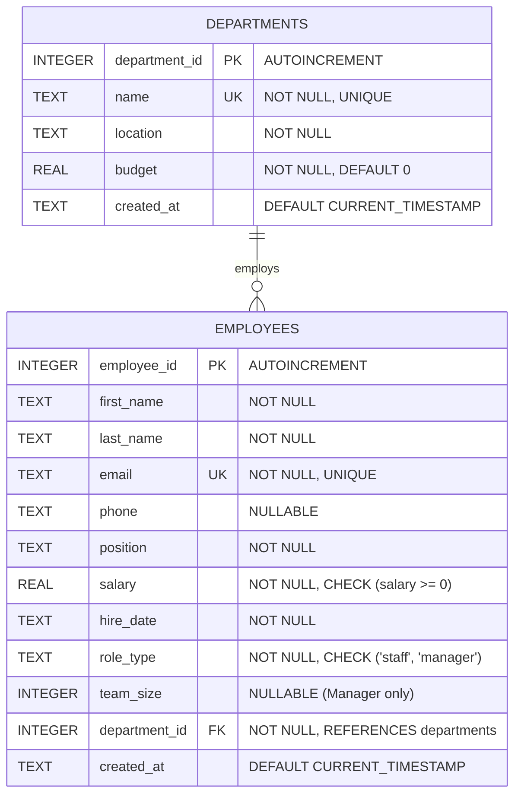

# Employee & Department Management System

A database-driven, object-oriented web application for managing company
departments and employees. Built with Python (Flask), SQLite, and Docker.

---

## 1. Quick Start

### Option A — Run with Docker (recommended for the defense)
```bash
# Create the DB file first so Docker mounts a file, not a folder
touch empdept.db

docker compose up --build
```
Visit **http://localhost:5000**

### Option B — Run locally without Docker
```bash
python3 -m venv venv
source venv/bin/activate        # Windows: venv\Scripts\activate
pip install -r requirements.txt
python app.py
```
Visit **http://localhost:5000**

The database (`empdept.db`) and demo seed data are created automatically
the first time the app starts.

---

## 2. Project Structure
```
empdept_manager/
├── app.py              # Flask routes (Controller)
├── models.py           # OOP classes + repositories (Model)
├── database.py         # DB connection handler
├── schema.sql          # SQL schema + seed data
├── templates/           # Jinja2 HTML templates (View)
├── requirements.txt
├── Dockerfile
├── docker-compose.yml
└── README.md
```
This follows a lightweight **MVC pattern**: `models.py` is the Model,
`templates/` is the View, `app.py` is the Controller.

---

## 3. Database Architecture & ER Model

### Cardinality
- **One-to-Many (1:N)**: One **Department** contains zero or more **Employees**. Each **Employee** belongs to exactly one **Department**.



---

## 4. Relational Database Normalization Proof (Up to 3NF)

| Normal Form | Requirement | How It Is Satisfied in This Project |
| :--- | :--- | :--- |
| **1NF (First Normal Form)** | Atomic columns, primary keys, and no repeating groups. | Every column holds an indivisible data value (e.g. `first_name` and `last_name` are separated). Each table possesses a surrogate Primary Key (`department_id`, `employee_id`). |
| **2NF (Second Normal Form)** | In 1NF and no partial functional dependencies (all non-key attributes fully depend on the full PK). | Both tables use single-column Primary Keys (`department_id` and `employee_id`). Therefore, partial functional dependency cannot exist. |
| **3NF (Third Normal Form)** | In 2NF and no transitive dependencies (no non-key attribute depends on another non-key attribute). | In `employees`, all employee attributes depend strictly on `employee_id`. Department details (`name`, `location`, `budget`) are stored in `departments` rather than duplicated in `employees`, eliminating update/insertion/deletion anomalies. |

> **Single-Table Inheritance**: The `employees` table stores both `staff` and `manager` roles, differentiated by `role_type`. The `team_size` column is populated for managers and `NULL` for staff. This is the standard **Single-Table Inheritance** pattern, chosen to avoid unnecessary table joins while maintaining sub-millisecond query retrieval.

---

## 5. Database Constraints & Data Integrity

1. **Entity Integrity**: `department_id` and `employee_id` are `INTEGER PRIMARY KEY AUTOINCREMENT`.
2. **Referential Integrity**: `FOREIGN KEY (department_id) REFERENCES departments(department_id) ON DELETE CASCADE ON UPDATE CASCADE`. Deleting a department automatically cascades to remove related employee records, preventing orphaned data.
3. **Domain Integrity**: `CHECK (salary >= 0)`, `CHECK (role_type IN ('staff', 'manager'))`, and `NOT NULL` on mandatory columns.
4. **Unique Constraints**: `departments.name UNIQUE` and `employees.email UNIQUE` prevent duplicate records.
5. **Runtime Foreign Key Enforcement**: SQLite disables foreign keys by default for backwards compatibility; our connection layer explicitly executes `PRAGMA foreign_keys = ON;` upon connection creation.

---

## 6. Query Optimization & Eliminating the N+1 Problem

### A. Solving the N+1 Query Problem in Department Listings
* **Naive Iterative Approach (Anti-pattern)**:
  Executing 1 query to fetch departments, followed by a loop in Python executing \(N\) separate `COUNT(*)` queries for each department (Total: \(1 + N\) queries).
* **Our Optimized SQL Approach (1 Query)**:
  We execute a single query using `LEFT JOIN` and `GROUP BY`:
  ```sql
  SELECT d.department_id, d.name, d.location, d.budget,
         COUNT(e.employee_id) AS employee_count
  FROM departments d
  LEFT JOIN employees e ON d.department_id = e.department_id
  GROUP BY d.department_id
  ORDER BY d.name;
  ```
  *Why `LEFT JOIN`?* A standard `INNER JOIN` would drop departments that currently have zero employees. `LEFT JOIN` guarantees all departments are returned with an accurate count of `0`.

### B. In-Database Aggregation vs. In-Memory Python Calculations
Instead of loading all employee rows across the network into application memory to calculate metrics, we delegate calculations to SQLite's C-level engine:
```sql
SELECT 
    COUNT(*) AS total_employees,
    COALESCE(SUM(salary), 0) AS total_payroll,
    COUNT(CASE WHEN role_type = 'manager' THEN 1 END) AS manager_count
FROM employees;
```

### C. B-Tree Indexing for Foreign Keys
Foreign keys are not automatically indexed by SQLite. We explicitly created:
```sql
CREATE INDEX idx_employees_department ON employees(department_id);
```
- **Performance Impact**: Searching, filtering, and joining employees by department drops from \(O(N)\) full-table scan to \(O(\log N)\) logarithmic B-Tree lookup.

---

## 7. Security: SQL Injection (SQLi) Prevention

All database interactions throughout `models.py` use **parameterized queries (prepared statements)** with `?` placeholders:
```python
# SECURE: SQL engine compiles the query template before binding parameters
cur.execute("SELECT * FROM departments WHERE department_id = ?", (department_id,))
```
User inputs are treated strictly as literal data, completely neutralizing SQL Injection attacks.

---

## 8. Crash-Resilient Error Handling

In production and live defense demonstrations, attempting to insert duplicate records (e.g., an existing email or department name) raises `sqlite3.IntegrityError`. 

The controller layer (`app.py`) captures these constraint violations gracefully:
```python
try:
    dept_repo.create(d)
    flash(f"Department '{d.name}' created successfully.", "success")
except sqlite3.IntegrityError:
    flash("A department with this name already exists (UNIQUE constraint violated).", "danger")
```
This prevents HTTP 500 crashes and provides clear visual feedback to examiners during testing.

---

## 9. SIWES Defense Panel Q&A Cheatsheet

Prepare for these high-probability questions during your database defense:

### Q1: Why did you choose SQLite over a client-server RDBMS like PostgreSQL or MySQL?
> **Answer**: SQLite is serverless, zero-configuration, transactional, and stores the entire database in a single cross-platform disk file (`empdept.db`). It is lightweight and ideal for embedded applications, testing, and self-contained demonstrations. Because we implemented the **Repository (DAO) pattern**, the data access layer is isolated; switching to PostgreSQL or MySQL would only require changing the connection driver in `database.py` without touching any business logic.

### Q2: How does your database maintain referential integrity?
> **Answer**: Referential integrity is enforced at the schema level using a Foreign Key constraint on `employees.department_id` pointing to `departments.department_id`, configured with `ON DELETE CASCADE` and `ON UPDATE CASCADE`. In SQLite, foreign key enforcement is turned on explicitly at connection initialization using `PRAGMA foreign_keys = ON;`.

### Q3: What is the N+1 query problem, and how did you resolve it?
> **Answer**: The N+1 query problem occurs when an application executes 1 query to fetch parent records and then executes \(N\) subsequent queries in a loop to fetch related child data, creating severe database latency. In our department listing, we resolved this by executing a single query combining `LEFT JOIN` and `GROUP BY`, aggregating employee counts directly within the database engine in a single round-trip.

### Q4: Why use `LEFT JOIN` instead of `INNER JOIN` when listing departments?
> **Answer**: An `INNER JOIN` only returns rows where there is a match in both tables. If a newly created department has no employees assigned yet, an `INNER JOIN` would exclude that department from the output. A `LEFT JOIN` retains all records from the left table (`departments`) and fills unmatched columns from the right table with `NULL`, allowing `COUNT(e.employee_id)` to evaluate to `0`.

### Q5: What are ACID properties and how does your database uphold them?
> **Answer**:
> - **Atomicity**: Transactions in SQLite are all-or-nothing; if an error occurs during execution, the transaction rolls back.
> - **Consistency**: Enforced through schema rules (`NOT NULL`, `CHECK (salary >= 0)`, `UNIQUE`, and Foreign Keys).
> - **Isolation**: SQLite provides serialized transactions using database locking mechanisms to prevent dirty reads.
> - **Durability**: Once a transaction is committed, changes are written directly to disk storage (`empdept.db`).

### Q6: Why did you create an index on `employees(department_id)`?
> **Answer**: In relational databases, primary keys are automatically indexed, but foreign keys are not. Since `department_id` is constantly used as a join condition and filtering predicate, creating a B-Tree index improves search performance from an \(O(N)\) full table scan to \(O(\log N)\) tree traversal.

### Q7: How does your system prevent SQL Injection?
> **Answer**: By strictly using parameterized queries with question-mark placeholders (`?`) provided by the Python DB-API. The database driver compiles the SQL structure separately from the input parameters, ensuring user data is never parsed as executable SQL commands.
